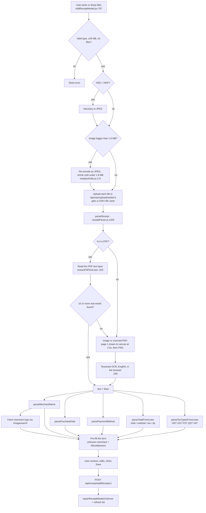

# Categorizr — Algorithms Explained

Plain-language walkthrough of the non-trivial logic in the project. No code was changed.
Line numbers refer to the files as they are now. Examples were traced by hand from the code (I did not run them).

**Contents**
0. [Big picture: the receipt extraction pipeline (flowchart)](#0-big-picture-the-receipt-extraction-pipeline)
1. [receiptParser.js](#1-receiptparserjs)
2. [Image compression and HEIC conversion](#2-image-compression-and-heic-conversion-mediaurlutilsjs)
3. [Chat router and AI call](#3-the-chat-assistant)
4. [Analytics, filters, sorting, grouping hooks](#4-analytics-filters-sorting-grouping)
5. [Auto-refresh and media repair](#5-auto-refresh-and-media-repair)
6. [Other algorithms worth knowing](#6-other-non-trivial-algorithms-i-found)

---

## 0. Big picture: the receipt extraction pipeline



Key idea: **there is no AI model here.** Text comes from the PDF itself or from Tesseract OCR, and everything after that is hand-written pattern matching (regular expressions, "regex") plus scoring rules.

---

## 1. receiptParser.js

All paths below are `Frontend/src/utils/receiptParser.js`.

### 1.1 PDF text layer vs. Tesseract — `extractReceiptData` (lines 263-345)

**What it does:** turns a file into `{ text, lines, words }`. `lines` and `words` carry positions (bounding boxes) so later steps can tell which numbers are on the right-hand side of the page.

```js
// :267-282
if (fileOrUrl instanceof File && isPDF(fileOrUrl)) {
  const pdfData = await extractPdfTextLines(fileOrUrl);
  const wordCount = (pdfData.text.match(/[A-Za-z0-9]{2,}/g) || []).length;
  if (wordCount >= 10) {
    return { text: pdfData.text, lines: pdfData.lines, words };   // use the PDF's own text
  }
  // too little text → fall through to OCR
}
const imageSource = await _prepareImageForOCR(fileOrUrl);          // :284
const worker = await Tesseract.createWorker('eng', 1, {...});      // :295
({ data } = await worker.recognize(imageSource, {}, { text: true, blocks: true }));
```

Step by step:
1. If the file is a **PDF**, ask pdf.js for its embedded text (`extractPdfTextLines`, :203). A "digital" PDF (e-receipt emailed by a shop) contains exact text, so this is perfect and instant.
2. Count "real words" (2+ letters/digits). **10 or more → trust it.** Fewer than 10 means the PDF is just a scanned picture.
3. Otherwise run **OCR**: a PDF page 1 is painted onto a canvas at 2.5x zoom and saved as PNG (`pdfToImage`, :54, `_prepareImageForOCR`, :173); a normal image goes straight in.
4. Tesseract returns a tree *blocks → paragraphs → lines → words*. The code flattens it into a flat `lines` list (:312-326). If the tree is empty it falls back to splitting plain text by newline (:331-337) but then loses positions.
5. A fresh Tesseract worker is created and terminated each time (:295, :307).

How the PDF text layer is rebuilt into lines (`extractPdfTextLines`, :203-254): every text piece has an x/y position. Pieces whose y values round to the same 4-pixel bucket (`Math.round(yTop / 4)`, :226) are one row; rows are sorted top to bottom; pieces in a row are sorted left to right and joined with spaces. Only the first 5 pages are read (:209).

**Example:** a Walmart e-receipt PDF with 300 words → text layer used, OCR never loaded. A phone photo → OCR. A scanned PDF with 3 words of text → falls back to OCR of page 1 only.

### 1.2 `parseMerchantName` (lines 381-483)

**What it does:** guesses the shop name, preferring the user's own merchant list.

Step by step:
1. Split text into non-empty lines. Only the **top 20 lines** are searched (:388).
2. For every saved merchant name longer than 3 characters, split into words ("home depot" → `home`, `depot`) and check how many words appear in those top lines (:394-412).
3. A merchant is a candidate only if: one-word name and that word was found, **or** multi-word name and **more than one** word found (:414-417).
4. Score = matched letters ÷ total letters × 100 (:418-419). All words matched = 100.
5. Sort candidates by score, then by number of words (longer name wins), then by earlier line (:431-435). Best one is returned, with a leading "THE / A / AN" removed (`normalizeMerchantName`, :367).
6. No match → try a **hard-coded list of 15 brands** with regexes (:453-469), first in the top 15 lines, then in the whole text (:471-480).
7. Still nothing → empty string; the form later shows "Miscellaneous" (`AddReceiptModal.jsx:2278`).

```js
// :414-420 scoring
if ((components.length === 1 && matchedComponentCount === 1) ||
    (components.length > 1 && matchedComponentCount > 1)) {
  const confidence = (componentMatchedLength / storeNameWithoutSpace.length) * 100;
```

**Example:** text `"HOME DEPOT\n#4211 ..."`, list `["Home Depot", "Depot Auto"]` → "Home Depot": 2 of 2 words, score 100. "Depot Auto": only 1 of 2 words → not a candidate. Returns `"Home Depot"`.

**Gotchas:** the fallback regexes are loose: `LOWE['S]?` also matches "LOWER" (so "LOWER PRICES" could return Lowe's), `WAL[MART]+` matches "WALT…", and `CVS`/`TARGET` match inside longer words. Because the 15-brand pass also scans the *whole text*, a stray word near the bottom can win.

### 1.3 `parsePurchaseDate` (lines 521-682)

**What it does:** finds the most likely purchase date and returns `YYYY-MM-DD`.

Step by step:
1. Define `tryAdd(y, m, d)` (:528-533): it adds a date to a candidate list only if it is a **real calendar date between years 2000-2100** (`isValidDate`, :504) and **not in the future**.
2. Clean each line (remove `|` and `\`, :536) and build a "corpus" = every line **plus the whole text** (:540-542). So each date is usually seen twice.
3. Run **13 patterns** on each corpus item: `YYYY-MM-DD HH:mm:ss`, `YYYY/MM/DD HH:mm`, `MM/DD/YYYY`, `YYYY/MM/DD`, `MM/DD/YY`, `MM-DD-YYYY`, `YYYY-MM-DD`, `15-Jan-2024`, `Jan 15, 2024`, `15 Jan 2024`, `Jan 15 2024`, `Oct08'22`, `DD-MM-YY`.
4. For ambiguous numeric patterns it adds **both** readings. `03/04/2025` adds March 4 *and* April 3 (:566-569).
5. Count how many times each date was found; keep those tied for the most (:672-677).
6. Among ties, pick the one **closest to today** (:680-681).

```js
// :562-569  ambiguous slash date: try both orders
const re = /\b(\d{1,2})\/(\d{1,2})\/(\d{4})\b/g;
while ((m = re.exec(s)) !== null) {
  tryAdd(+m[3], +m[1], +m[2]); // MM/DD/YYYY
  tryAdd(+m[3], +m[2], +m[1]); // DD/MM/YYYY alternative
}
```

**Examples** (today = 2026-11-16):
- `"Date: 03/25/2025"` → March 25 valid, "25th month" invalid → `2025-03-25`.
- `"03/04/2025"` → both valid, same count, tie → the one nearer today = **April 3** → `2025-04-03`. So for any ambiguous past date the **later** reading always wins, even for a US receipt (March 4). *(I corrected the wording about this in ANALYSIS.md.)*
- `"2025-03-04 10:15:00"` matches both pattern 1 and pattern 7, so it gets a higher count and beats other dates on the page.

### 1.4 `parsePaymentMethod` (lines 692-890)

**What it does:** returns text like `"MasterCard *7836"` (card brand + last 4 digits) or just `"Visa"` / `"Cash"`.

It tries recipes **in this order and returns on the first hit**:
1. **Terminal block** (:702-729): a `CARD NUMBER: ***7836` line gives the last 4; the brand comes from an `ACCT: MASTERCARD` line, or the nearest brand word within 140 characters before it.
2. **Number + brand together** (:747-759): `XXXXXXXXXXXX7836 MASTERCARD`.
3. **Brand keyword scan** (:731-744, :762-781): go through the brand list in order (Amex, MasterCard, Visa, Discover, Diners, PayPal, Debit, Credit Card, Cash). On the first brand found, look ±100 characters around it for `****1234`/`XXXX1234`. Found → `"Brand *1234"`; not found → just `"Brand"`, **and the function returns right there** (:779).
4. Bare 16-digit number, masked patterns, `X…X1234`, and "iOS-style" patterns (:784-886). Because step 3 returns as soon as *any* brand word exists, these later steps only run when **no** brand word appears in the text at all; they then fall back to `"Card *1234"` or guess the brand from the first digit (5 = MasterCard, 4 = Visa, 3 = Amex, 6 = Discover, :797-804).

**Example:** `"ACCT: MASTERCARD\nCARD NUMBER: ***********7836 P"` → step 1 → `"MasterCard *7836"`.
**Example:** `"Paid by CASH"` → `"Cash"`. `"CASH BACK $20 ... VISA ****1234"` → Visa comes before Cash in the list → `"Visa *1234"`.

### 1.5 `parseTotalFromLines` (lines 978-1032) and its helper

**What it does:** finds total, subtotal, tax and tip from the OCR lines.

Step by step:
1. For each line, pull the **first price** out of it (`extractPriceFromText`, :900-916: tries `$1,234.56`, `$12.34`, `1,234.56`, `12.34`). No price → skip the line.
2. **Total**: the line has the *word* "total" but not "sub…" or "tax" (:996-999), **or** one of `amount | payment | due | balance` (:1002). If several lines qualify, **the largest price wins** (:1007), not the last one.
3. **Subtotal**: first line matching `subtotal | sub total | sub-total` (:1010).
4. **Tax**: first line with the word "tax" but not "total" (:1014). **Tip**: first line with `tip | gratuity` (:1018).
5. **Fallback if no total** (:1024-1028) → `findRightColumnPrices` (:925-967): collect every price with the x-position of its right edge, keep prices within 75 % of the furthest-right x (the "price column"), sort big→small; **biggest = total, second = subtotal**.

```js
// :996-1008
const isTotal = /\btotal\b/.test(lineLower) && !/\bsub/.test(lineLower) && !/\btax\b/.test(lineLower);
const isAmount = /\b(amount|payment|due|balance)\b/.test(lineLower) && !/\bsub/.test(lineLower);
if (isTotal || isAmount) { if (total === null || price > total) total = price; }
```

**Example:**
```
SUBTOTAL   10.00   → subtotal = 10.00   ("subtotal" is one word, so \btotal\b does NOT match it)
TAX         1.30   → tax = 1.30
TOTAL      11.30   → total = 11.30
```
Result `{ total: 11.30, subtotal: 10.00, taxAmount: 1.30, tip: null }`.

**Gotcha:** a line like `AMOUNT TENDERED 20.00` or `PAYMENT 20.00` also counts as a "total", and the *largest* wins, so cash paid can replace the real total (the comment at :1005 says "lowest/last", but the code keeps the highest).

**Related:** `parseTaxTypesFromLines` (:1043-1107) finds named taxes HST/GST/PST/QST/VAT (max 2). Pass 1 collects a printed rate (`13%`) per label from any line; pass 2 reads each labelled line's amount, skipping subtotal/total rows and registration-number lines (`R135772911`). The rate is the printed one, else the one from pass 1, else `amount ÷ subtotal × 100`. Amounts bigger than 1.5 × subtotal are ignored as "probably an ID number".

---

## 2. Image compression and HEIC conversion (`mediaUrlUtils.js`)

**Why it exists** (comment at :141-142): the upload endpoint rejects bodies over ~2 MB and Vercel rejects over 4.5 MB, but phone photos are 3-10 MB.

### `convertHeicToJpegIfNeeded` (:225-243)
1. `isHeicFile` (:133): MIME is `image/heic|heif` **or** the name ends in `.heic/.heif` (iPhones often report an empty MIME).
2. If HEIC → dynamically load `heic2any` and convert to JPEG at quality 0.9, renaming to `.jpg`.
3. If conversion **fails**, return the original file (:238-239) — note it skips compression in that case.
4. Pass the result to `compressImageIfNeeded`.

### `compressImageIfNeeded` (:174-217)
1. If file ≤ 1.8 MB, or not an image, or GIF/SVG → return unchanged (:175-179).
2. Decode with `createImageBitmap` (respecting the photo's rotation) or an `` fallback (:146-167).
3. Start with `scale = min(1, 2400 / longest side)` and `quality = 0.85` (:186-187).
4. Loop up to 7 times (:189-204): draw onto a white canvas at that scale, export JPEG; **stop when ≤ 1.8 MB**. Otherwise lower quality by 0.1 (not below 0.5) and, from the 2nd retry on, shrink the size by 15 %.
5. If the result is not smaller than the original, keep the original (:206). Otherwise return a new `.jpg` file.

**Example:** 4000×3000 JPEG, 6 MB → scale 0.6 → 2400×1800 at q 0.85 → ~1.2 MB → done in one pass. A 9 MB image might need two or three rounds (q 0.75, 0.65, then smaller).

**Gotcha:** if all 7 tries stay above 1.8 MB, the last blob is still returned, so a very large detailed image can still be rejected later. PDFs are never compressed (so a big PDF can still fail the 4.5 MB Vercel limit).

`sanitizeUploadFile` (:113-130) then renames the file to `image_<time>_<random>.<ext>` so commas/spaces in names don't break the comma-separated media field.

---

## 3. The chat assistant

### 3.1 The intent router — `processMessage` (`hooks/useChatAssistant.js:67-172`)

**What it does:** decides whether it can answer from data already in the browser, or must call the AI. It is a **top-to-bottom if/else chain; first match wins**, using `normalized.includes("...")` on the lower-cased message:

| Order | Triggers (substring) | Handler |
|---|---|---|
| 1 | "forgot/reset password", "logout/sign out", "add/upload receipt" | canned help text |
| 2 | "how much", "total", "spent", "spend" | `handleSpendingQuery` (:233) |
| 3 | "by category", "categories", "breakdown" | `handleCategoryBreakdown` |
| 4 | "payment", "card", "method" | `handlePaymentQuery` |
| 5 | "average" | `handleAverageQuery` |
| 6 | "merchant", "store", "from", **"at "** | `handleMerchantQuery` (:422) |
| 7 | "find", "search", "bought", "do i have"… | `handleSearchQuery` (:584) |
| 8 | "show", "list", "receipts" | `handleReceiptListQuery` |
| 9 | "compare", "vs", "versus" | `handleComparisonQuery` |
| 10 | anything else | `handleAIQuery` (:647) → server → OpenAI |

**Example input → output:**
`"How much did I spend on groceries last month?"` → matches row 2 → `handleSpendingQuery` finds the category word "groceries" in `availableCategories`, finds the phrase "last month" in a list of period phrases (:253-263), calls `getSpendingForCategory("Groceries","last month")` →
`"You spent $212.40 on Groceries last month across 7 transactions."`

`handleSearchQuery` (:584-640): removes stop words ("find", "the", "for"...) and words ≤ 2 letters, then keeps receipts whose store + product + notes + category text contains **any** remaining term.
`handleComparisonQuery` (:527-579): collects up to 2 period phrases found in the message and calls `compareSpending`; default is this month vs last month.

**Gotchas:** order matters. "compare spending this month vs last month" hits row 2 ("spend") before row 9. `"at "` matches inside "wh**at** ..." and "th**at** ...", sending many generic questions to the merchant handler.

### 3.2 The AI call (`server/services/aiService.js:33-92`)

Only messages that match no row above reach it.

1. Browser builds a **context** (`useChatAssistant.js:651-676`): totals, categories, top-5 categories/merchants, payment methods, and up to 50 recent receipts, and POSTs `{message, context}` to `/api/chat/query`.
2. Server checks the message is a string (`chatController.js:16`).
3. No `OPENAI_API_KEY` → return a canned fallback (:36-39).
4. `formatContextForAI` (:94-128) writes the context as plain text lines:
   ```
   Total Receipts: 42
   Total Spending: $1234.50
   Expense Categories: Food, Fuel
   Top Categories by Spending:
     1. Food: $600.00 (20 receipts)
   ```
   (the `recentReceipts` are **not** included in this production version).
5. POST to OpenAI Chat Completions with model `OPENAI_MODEL` (default `gpt-4o-mini`), `temperature 0.7`, `max_tokens 500`, messages = [system prompt, one user message: *"Here is the user's receipt data summary: … User question: …"*] (:44-65).
6. Take `choices[0].message.content` and return it as `{type:"text", message}` (:80-87).
7. Any error or empty reply → `getFallbackResponse` (:130-194): simple keyword matches ("total", "category", "merchant") that print numbers straight from the context.

**Example:** message `"Is my food spending high?"` + context above → the model replies something like *"Food is your top category at $600 of $1,234.50 (about 49%)."*

---

## 4. Analytics, filters, sorting, grouping

### 4.1 `useReceiptAnalytics` (+ `utils/receiptAnalytics.js`)

A hook that wraps pure helper functions in `useMemo`, so numbers are recomputed only when `receipts` changes.

- **`validatePrice`** (:13-35): empty/NaN → 0; anything beyond ±1,000,000 is treated as corrupted → 0.
- **`groupByCategory / Merchant / PaymentMethod / ReceiptType / Month`** (:67-172): one `reduce` that builds `{ "Food": {total, count, receipts[]} }`. Missing names become "Uncategorized"/"Unknown". Months use **UTC** so the month matches the date printed on the receipt.
- **`getTopSpenders`** (:180-185): turn the object into an array, sort by total descending, take N.
- **`parseDateExpression`** (:262-388): turns words into a date range. Checked in this order: explicit year → "month year" → today → yesterday → this/last week → this/last month → this year/ytd → last year → last 7/30/90 days → a bare month name. Weeks start on Sunday (`getDay()`).
- **`filterByDateRange`** (:194-207): compares whole calendar days, both ends inclusive.
- **`compareSpending`** (hook :182-200): `difference = p1 − p2`; `percentChange = (p1−p2)/p2×100` (0 if p2 = 0); trend increase/decrease/same.
- **`getSpendingSummary`** (:409-441): total, count, average, min, max — but only over receipts with price **> 0**.

**Example:** receipts `Food 10, Food 20, Fuel 30` → `groupByCategory` = `{Food:{total:30,count:2}, Fuel:{total:30,count:1}}` → `getTopSpenders(…,1)` → `[{name:"Food" or "Fuel", total:30…}]` (tie keeps insertion order).

**Gotchas:**
- `filterByCategory/Merchant/PaymentMethod` use "either string contains the other" (:221, :237, :253). An **empty** receipt category satisfies `"groceries".includes("")`, so receipts with no category match *every* category query.
- `getSpendingSummary` drops zero and negative amounts, so **refunds are ignored** in `overallSummary`, while `calculateTotalSpending` does include negatives. The two can disagree.

### 4.2 `useReceiptFilters` (+ `utils/receiptFilters.js`)

State is a plain object `{price, date, merchant, expenseCategory, receiptCategory, paymentMethod, taxTypes, tags, …}`, saved to `localStorage` after every change (skipping the first render so defaults do not overwrite saved values, :73-88). Dates are revived from strings on load (`reviveDateRange`, :20-28).

Filtering itself (`filterReceipts`, `receiptFilters.js:236-250`) is an **AND of nine small tests**; a receipt must pass all of them:

1. `matchesSearch` – lower-cased search text is a substring of any of: store, category, payment, description, notes, "personal/business", price, formatted date; plus bank aliases ("boa" → Bank of America, "amex" → American Express, :15-25).
2. `matchesPrice` – `>= value` or `min ≤ price ≤ max`.
3. `matchesDate` – whole days, inclusive; **undated receipts are excluded** whenever a range is active (:95-96).
4. `matchesMerchants` – exact match after trimming, curly quotes → `'`, lower-casing.
5. `matchesCategory` / 6. `matchesReceiptCategory` – exact (case-insensitive) / `"0"|"1"`.
7. `matchesPaymentMethod` – compare normalised keys.
8. `matchesTaxTypes` – any selected tax label present (Tip handled specially).
9. `matchesGroupedTags` (:192-232) – tags come in pairs (verified/unverified…). For each pair: none selected **or both selected = "All" = no restriction**; one selected = must satisfy that predicate.

**Example:** filters `{merchant:["Walmart"], price:{type:"range",min:10,max:50}}`, search `"milk"` → keeps only Walmart receipts with total 10-50 whose notes/store/etc. contain "milk".

### 4.3 `useReceiptSorting` (+ `utils/receiptSorting.js`)

The hook stores one active sort (`{order|date|amount}`; choosing one resets the others, :44-49) in `localStorage`. The real work is comparator chains in `sortReceipts` (:78-122):

- **Default** (`compareByDayThenTotal`, :72): newest **calendar day** → highest **total** (compared in **cents**, so `12.5` = `"12.50"`) → description A-Z (or merchant if blank) → merchant A-Z → receipt id newest first. The id step guarantees a stable, repeatable order.
- **Amount sort:** total first, then the same tie-breakers.
- **Date sort:** day first, then within-day order.
- **Name sort:** merchant A-Z/Z-A first, then day, then within-day order.
- `dayOf` = `floor(unixSeconds / 86400)`: a UTC day bucket, so split/duplicate receipts that share a date group together.
- Text comparison is pinned to English (`localeCompare(b, "en", …)`) so order is the same on every device.

**Example:** three receipts on the same day with totals 12.50, 30, 12.50 and names "Zoo", "Bar", "Apple" → 30 (Bar), then the two 12.50s alphabetically: Apple, Zoo.

### 4.4 `useReceiptGrouping` (`hooks/useReceiptGrouping.js:34-105`)

A four-stage pipeline, each stage a `useMemo`:
1. **Split drafts vs regular** (:38-53). Draft = `is_draft === "1"`, or an emailed receipt (has an email id, not forwarded from a network user) not yet verified (:16-29). Drafts are sorted and filtered, then shown in their own section on top.
2. **Filter** regular receipts (`filterReceipts`).
3. **Sort** (`sortReceipts`).
4. **Group by year** (:63-95): year from `product_date` in UTC, or `"No Date"`. Compute each year's total (sum of `purchasePrice`), then order the years with `sortYears` (`receiptSorting.js:124-151`): follows the active sort (newest/oldest, total asc/desc, A-Z) and always puts **"No Date" last**.

**Example:** receipts dated 2025, 2024, 2025, none → `{2025:[…2], 2024:[…1], "No Date":[…1]}`, years `[2025, 2024, "No Date"]`, `yearTotals` = sum per year.

---

## 5. Auto-refresh and media repair

### 5.1 `useAutoRefresh` (`hooks/useAutoRefresh.js:11-46`)

**What it does:** quietly re-loads receipts so new emailed/forwarded ones appear.

1. Keep the latest `refresh` function in a ref so the timer never uses a stale one (:12-17).
2. Every `intervalMs` (default **20 s**), and also when the window gets **focus** or becomes **visible**, call `run`.
3. `run` does nothing if: the tab is hidden, the browser is offline, or the previous refresh is **still running** (`inFlightRef`) (:25). So requests never pile up.
4. Cleanup removes the timer and listeners (:38-43).

**Example:** user switches to another tab for 10 min → no requests; returns → one immediate refresh, then every 20 s. A slow refresh taking 30 s causes the next tick to be skipped.

### 5.2 `repairReceiptMediaOnServer` (`context/DataContext.jsx:2751-2779`)

**Background:** the backend upload endpoint (`uploadmediaV1`) **attaches every newly uploaded file URL to many receipts** (see comments :2637, :2728). The web app cleans this up on its own after every upload.

Step by step:
1. Get the receipts as the server last returned them (`lastRawReceiptsRef`); with `force` (right after an upload) re-fetch them (:2756-2763).
2. **`dedupeReceiptMediaAcrossReceipts`** (`mediaUrlUtils.js:473-548`) decides who owns each URL:
   - Rank each receipt: `create_date × 1e10 + id` (`receiptMediaRank`, :274) — **newest receipt owns the URL** (:482-495).
   - A receipt that is *not* the owner still keeps the URL if any of these "intentional sharing" rules hold: created within **60 s** of the owner (:505-508); both are in a recorded **split family** (:511-516); or they have the **same store name** (:522-529).
   - Otherwise its media fields become `"0"`.
3. **`healContaminatedReceiptMediaOnServer`** (:2641-2724) compares each raw receipt's media key with the cleaned one and keeps only those that differ. It skips new, unopened forwarded receipts (:2660) because a write would mark them read.
4. Safety valves: only one heal at a time (`mediaHealInFlightRef`, :2647); a **signature** string of "id:cleanedMedia" pairs identifies the problem; without `force`, the same signature waits **15 s** (:2671, :2683) and is abandoned after **8 failures** (:2672, :2676).
5. For each receipt to fix, send the cleaned row with `updateReceiptv1` one at a time (:2698-2707); count failures; reset the counter on full success.
6. If it worked and `force` was set, refresh the list silently (:2773-2775).

**Example:** you upload `bill.jpg` and the server adds its URL to receipts #10 (Shell), #11 (Costco) and #12 (the new Costco one). Owner = #12 (newest). #11 has the same store → keeps it. #10 (different store, not within 60 s) → URL removed. The app sends one update for #10.

**Gotchas:** every upload can cause extra writes to other receipts (full-row replace). Also, `create_date × 1e10` is about 1.7×10¹⁹, larger than JavaScript's exact-integer limit (~9×10¹⁵), so the `id` part of the rank is probably lost to rounding; ties then fall back to list position (`index`).

---

## 6. Other non-trivial algorithms I found

| Where | What it does (short) |
|---|---|
| `receiptParser.js:925-967` `findRightColumnPrices` | Price-column heuristic (see 1.5) |
| `receiptParser.js:1043-1107` `parseTaxTypesFromLines` | Two-pass named-tax detection (see 1.5) |
| `receiptParser.js:203-254` `extractPdfTextLines` | Rebuilds lines from PDF text pieces by y-position buckets |
| `mediaUrlUtils.js:7, 30-38` `splitMediaField` | Splits a comma-joined list of URLs using a regex that only splits on commas *followed by* `http(s)://`, so commas in file names survive |
| `mediaUrlUtils.js:338-357` `dedupeEmailAttachmentPdfUrls` | If both a stored-cloud copy and an email-server copy of the same PDF exist, hide the email-server one |
| `mediaUrlUtils.js:419-438` `mergeConnectedFamilies` | Merges overlapping groups of receipt ids (a split of a split) until none overlap — a "connected components" merge |
| `receiptSorting.js:25` `dayOf` | UTC day bucket for date-grouping and tie-breaking |
| `AddReceiptModal.jsx:123-134` `withDuplicateDefaultProductName` | Duplicate naming: "Lunch" → "Lunch (2)"; "Lunch (2)" → "Lunch (3)"; blank stays blank |
| `DataContext.jsx:84-92` `_forwardMerchantCreateLocks` etc. | In-memory "locks" so two overlapping sync runs do not both create the same merchant/category (prevents duplicates like two "Bose") |
| `DataContext.jsx:140-145` `expireSession` | Only logs out if the token that failed is still the current token, so a late reply from an old login can't sign out a new one |
| `DataContext.jsx:100-116` `buildPaymentMethods` | Builds a de-duplicated, case-insensitive list of payment labels, skipping empty/`0*0` values |
| `receiptFilters.js:192-232` `matchesGroupedTags` | "All / one side / both sides" tag logic (see 4.2) |
| `utils/authStorage.js:27-51` `clearAuthLocalStorage` | Saves a whitelist of keys, clears everything, restores the whitelist (logout without losing "already seen" tracking) |
| `Login.jsx:73-99` | Detects a *different* user logging in and wipes local data then hard-reloads |
| `SessionManager.jsx:9-40` | 30-minute idle timer reset by mouse/keys/scroll/touch/visibility |
| `server/.../integrationsController.js:816-822` | QuickBooks subtotal check: trust the receipt subtotal only if `subtotal + taxes + tip ≈ total` (±1 cent), else use `total − taxes − tip` |
| `integrationsController.js:944-989` | Builds QuickBooks expense lines: one main line plus one line per tax and a tip line, each linked to an account found or created by name |
| `integrationsController.js:1342` + `:1162-1183` | Update-vs-create: if a receipt was already pushed, fetch its SyncToken and update instead of duplicating; attachments are not re-uploaded on update |
| `integrationsController.js:90-117, 185-194` | OAuth `state` packing (user id + return origin + nonce, base64url) and a return-origin allow-list |
| `Frontend/api/_lib/forwardAuth.js:71-131` | Credential proxy: refuses credentials in the incoming URL, rebuilds them upstream |
| `legacyReceiptWrite.js:34-44` | Route matcher: only allow-listed receipt write endpoints are proxied |
| `vite.config.js:103-212` | A second copy of the chat handler for local dev (differs from production, see ANALYSIS.md M-4) |

**Files I did not read, so I cannot explain their algorithms:** `taxTypeUtils.js` (e.g. `resolveOcrDetectedTaxes`), `paymentMethodUtils.js` (matching/normalising payment methods), `receiptDate.js` (calendar-day helpers), `merchantListUtils.js` (`findRenamedApiMerchant`), `reportGenerators.js`, and the forward-sync logic in `DataContext.syncForwardedReceiptData`. Say the word and I will add them.
